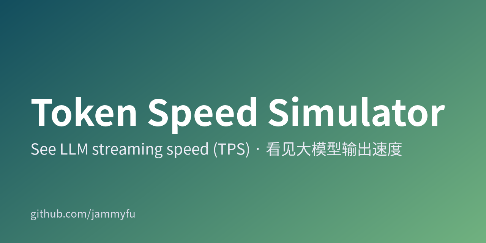
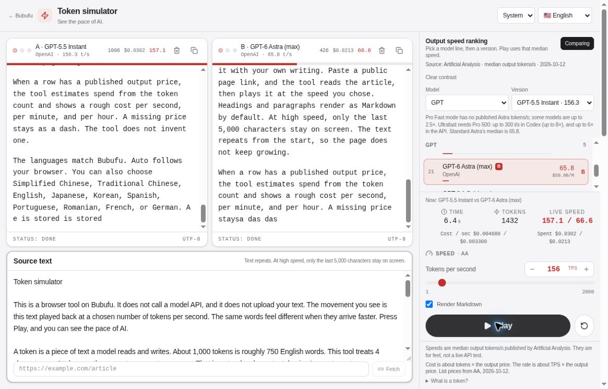

[简体中文](README.md) · [繁體中文](README.zh-TW.md) · [English](README.en.md) · [日本語](README.ja.md) · [한국어](README.ko.md)

# Token Speed Simulator

Feel the difference between 20, 50 and 200 tokens per second before buying API credits.

[**Try the simulator →**](https://bubufu.com/tools/token-speed-simulator/en/)





## Start in 30 seconds

1. Pick a model family and version, or set **1–2000 TPS** manually.
2. Press **Play** to see the same text arrive at that pace.
3. Enable **Compare** and assign another model as B. Both panes share the source text, so the difference is easy to see.

> This is a **browser text-playback simulator, not a live model benchmark**. Playback makes no model API call and needs no API key. The image above is a genuine A/B playback screenshot from the deployed product, not generated demo art.

## What can you use it for?

| Your question | Try this | What you learn |
| --- | --- | --- |
| How different do 20 and 100 TPS feel? | Same text, two speeds | Perceived reading delay |
| How fast should a chat product be? | Paste a sample response | A concrete streaming-UX discussion |
| What might extra speed cost? | Select a row with an output price | Output-cost scale, not a bill |
| How do I explain tokens/s? | Play or compare two streams | A live, understandable illustration |

Includes Markdown rendering, editable source text, model-family filters, and light/dark themes. The app supports **10 languages**: Simplified Chinese, Traditional Chinese, English, Japanese, Korean, Spanish, Portuguese, Romanian, French and German. This repository provides five complete reading guides.

## Read the numbers correctly

- **Approximate tokens**: playback treats 4 characters as about 1 token, not a model tokenizer. Exact token counts differ across Chinese, Japanese, Korean and English.
- **Snapshots, not live rankings**: the main source is Artificial Analysis dated 2026-10-12; individual rows have their own dates and sources, including DeepSeek updates on 2026-10-17. OpenRouter p50 and vendor-reported peaks are not equivalent to AA median measurements.
- **Output cost only**: approximately simulated tokens × USD output price ÷ 1,000,000. Input, cache, reasoning tokens, discounts and real billing are excluded. Missing prices stay missing.
- **Not latency or quality testing**: network, queueing, context length and device rendering can change real experience. Do not use the table to rank quality or promise production throughput.
- Text loops; only the last 5,000 characters remain visible to prevent unbounded page growth.

## Run locally

Install Node.js LTS and npm, then run:

```bash
git clone https://github.com/jammyfu/TokenSpeedSimulator.git
cd TokenSpeedSimulator
npm ci
npm run dev
```

Open **http://localhost:3000/tools/token-speed-simulator/**. Playback does not require `.env.local` or a Gemini/API key.

```bash
npm run lint
npm run build
npm run preview
python3 tools/verify.py
```

Build output is `dist/`; the default deployment base is `/tools/token-speed-simulator/`, not the domain root. Vite dev/preview provides a page-fetch endpoint. Static hosting needs a corresponding backend; the client also attempts direct fetching and a Jina Reader fallback.

## Privacy, sources and questions

**Is my text sent to a model?** No, playback runs in your browser. **Page fetching is different**: the target URL is sent to a fetch endpoint and may be sent to Jina Reader on fallback. Use public pages only, never private links, access tokens or sensitive URL parameters.

**Which model is fastest right now?** This project cannot establish a live winner. Check the [original leaderboard](https://artificialanalysis.ai/leaderboards/models) and each row's date.

**Can I reuse the code commercially?** The repository currently has no LICENSE. Public access is not a commercial reuse grant; ask the maintainer first. Do not label it MIT.

## Develop and contribute

- [Data / 数据 / 資料 / データ / 데이터](src/data/modelSpeedRankings.ts) · [Playback](src/hooks/useTokenStream.ts) · [Constants](src/constants.ts)
- [Contributing](CONTRIBUTING.md) · [Security](SECURITY.md) · [Roadmap](MASTER_PLAN.md) · [Current plan](CURRENT_PLAN.md)
- [Project brief](PROJECT_BRIEF.md) · [Backlog](TODO_BACKLOG.md) · [Worklog](docs/project-governance/WORKLOG.md)
- [Automation](docs/AUTOMATION_COMMANDS.md) · [Autonomy](docs/LONG_RUNNING_AUTONOMY.md) · [llms.txt](llms.txt)

Submit data corrections with a source URL, measurement definition and verification date, or UI issues with reproduction steps. Do not combine incompatible measurements into one ranking. If this helps you explain TPS, Star it to find it for your next demo.
