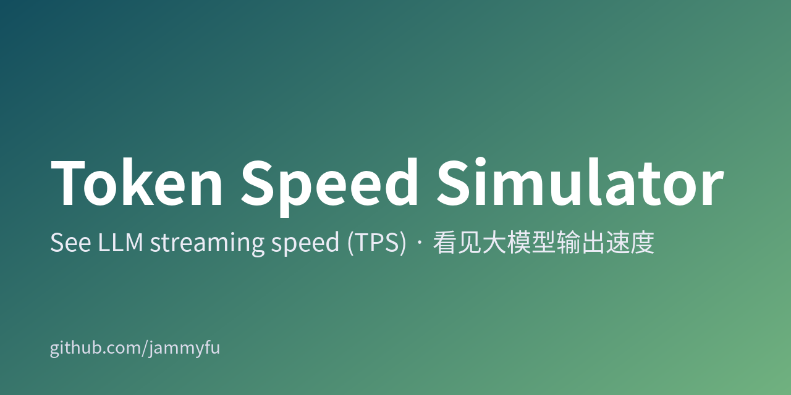
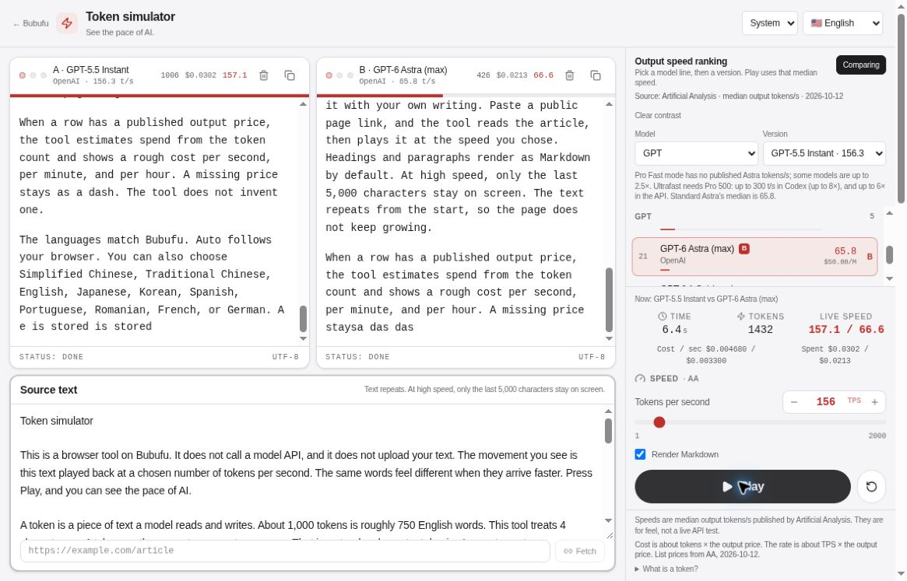

[简体中文](README.md) · [繁體中文](README.zh-TW.md) · [English](README.en.md) · [日本語](README.ja.md) · [한국어](README.ko.md)

# Token Speed Simulator

API クレジットを買う前に、20・50・200 TPS の体感差を確かめよう。

[**今すぐ試す →**](https://bubufu.com/tools/token-speed-simulator/ja/)





## 30 秒で始める

1. モデルの系列とバージョンを選ぶか、**1–2000 TPS** を手動で指定します。
2. **再生**を押して、同じ文章が表示される速さを見ます。
3. **比較**を有効にし、別のモデルを B に設定します。同じ原文を使うため、速度の違いを比較しやすくなります。

> これは**ブラウザー上の文字再生シミュレーターであり、実際のモデルのベンチマークではありません**。再生時にモデル API は呼び出さず、API キーも不要です。上の画像は公開版で A/B 再生を行った実際の画面であり、生成したデモ画像ではありません。

## どんな場面で役立つ？

| 知りたいこと | 試すこと | 分かること |
| --- | --- | --- |
| 20 TPS と 100 TPS はどれくらい違う？ | 同じ文章を異なる速度で再生 | 読むときの待ち時間の感覚 |
| チャット製品にはどのくらいの速さが必要？ | サンプル回答を貼り付ける | ストリーミング UX を具体的に検討 |
| 速くなると費用はどれくらい増える？ | 出力単価のあるモデルを選ぶ | 請求額ではなく出力費用の目安 |
| tokens/s をどう説明する？ | 再生または A/B 比較 | その場で見せられる実演 |

Markdown 表示、原文編集、モデル系列フィルター、ライト／ダークテーマに対応しています。アプリは **10 言語**に対応：中国語（簡体字・繁体字）、英語、日本語、韓国語、スペイン語、ポルトガル語、ルーマニア語、フランス語、ドイツ語。本リポジトリのガイドは 5 言語で提供しています。

## 数値の読み方

- **トークン数は概算**：4 文字を約 1 トークンとして再生し、モデルのトークナイザーは使いません。中国語、日本語、韓国語、英語の正確なトークン数をこの比率で換算することはできません。
- **スナップショットであり、リアルタイム順位ではありません**：主な出典は 2026-10-12 の Artificial Analysis。各行には個別の出典や日付があり、DeepSeek の 2026-10-17 更新も含まれます。OpenRouter p50 やメーカー公表のピーク値は、AA の中央値と同じ測定条件ではありません。
- **出力費用のみの概算**：模擬トークン数 × 米ドル出力単価 ÷ 1,000,000。入力、キャッシュ、推論トークン、割引、実際の課金は含みません。不明な価格は空欄のままです。
- **初回応答遅延や品質は測りません**：ネットワーク、待ち行列、コンテキスト長、端末の描画性能により実際の体験は変わります。品質評価や本番環境の速度保証には使わないでください。
- 文章は繰り返し再生され、ページが無制限に増えないよう末尾 5,000 文字だけを表示します。

## ローカルで実行

Node.js LTS と npm を用意して、次を実行します。

```bash
git clone https://github.com/jammyfu/TokenSpeedSimulator.git
cd TokenSpeedSimulator
npm ci
npm run dev
```

**http://localhost:3000/tools/token-speed-simulator/** を開きます。再生だけなら `.env.local` や Gemini/API キーは不要です。

```bash
npm run lint
npm run build
npm run preview
python3 tools/verify.py
```

ビルド結果は `dist/` に出力されます。既定の配置先はドメイン直下ではなく `/tools/token-speed-simulator/` です。Vite の開発／プレビューサーバーはページ取得用エンドポイントを提供します。静的ホスティングには対応するバックエンドが必要で、クライアントは直接取得と Jina Reader へのフォールバックも試みます。

## プライバシー・出典・よくある質問

**文章はモデルに送信されますか？** いいえ。再生はブラウザー内で行います。ただし**ページ取得は別**です。対象 URL は取得用エンドポイントに送信され、フォールバック時は Jina Reader に送信される場合もあります。公開ページだけを使い、非公開リンク、アクセストークン、機密パラメーターを含む URL は入力しないでください。

**今一番速いモデルは？** このツールはリアルタイムの最速モデルを確定できません。[元のランキング](https://artificialanalysis.ai/leaderboards/models)と各行の日付を確認してください。

**コードを商用利用できますか？** 現在 LICENSE ファイルはありません。公開されていることは商用再利用の許諾を意味しません。まず管理者に確認し、MIT と表記しないでください。

## 開発と貢献

- [データ定義](src/data/modelSpeedRankings.ts) · [再生処理](src/hooks/useTokenStream.ts) · [定数](src/constants.ts)
- [貢献方法](CONTRIBUTING.md) · [セキュリティ](SECURITY.md) · [ロードマップ](MASTER_PLAN.md) · [現在の計画](CURRENT_PLAN.md)
- [プロジェクト概要](PROJECT_BRIEF.md) · [バックログ](TODO_BACKLOG.md) · [作業記録](docs/project-governance/WORKLOG.md)
- [自動化](docs/AUTOMATION_COMMANDS.md) · [継続運用](docs/LONG_RUNNING_AUTONOMY.md) · [llms.txt](llms.txt)

データ修正には出典 URL、測定条件、確認日を、画面の不具合には再現手順を添えてください。異なる測定方法を一つの順位に混ぜないでください。TPS の説明に役立ったら、次のデモで見つけやすいよう Star を付けてください。
