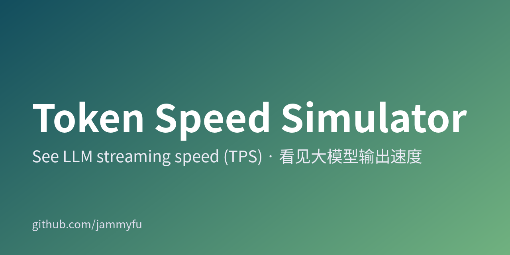
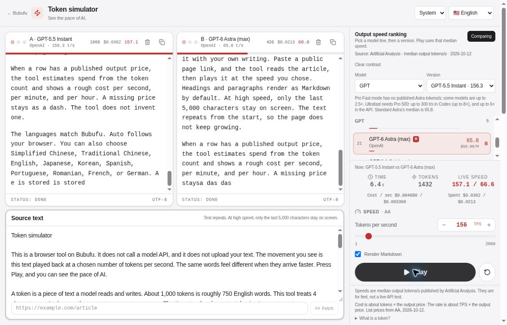

[简体中文](README.md) · [繁體中文](README.zh-TW.md) · [English](README.en.md) · [日本語](README.ja.md) · [한국어](README.ko.md)

# Token Speed Simulator

API 크레딧을 구매하기 전에 20·50·200 TPS의 체감 차이를 확인하세요.

[**바로 사용하기 →**](https://bubufu.com/tools/token-speed-simulator/ko/)





## 30초 만에 시작하기

1. 모델 계열과 버전을 선택하거나 **1–2000 TPS**를 직접 설정합니다.
2. **재생**을 눌러 같은 글이 출력되는 속도를 확인합니다.
3. **비교**를 켜고 다른 모델을 B로 지정합니다. 두 창이 같은 원문을 사용하므로 속도 차이를 쉽게 볼 수 있습니다.

> 이 도구는 **브라우저 텍스트 재생 시뮬레이터이며 실제 모델 벤치마크가 아닙니다**. 재생 중 모델 API를 호출하지 않으며 API 키도 필요하지 않습니다. 위 이미지는 배포된 제품에서 A/B 재생을 실행한 실제 화면 캡처이며 생성한 예시 이미지가 아닙니다.

## 어디에 활용할 수 있나요?

| 궁금한 점 | 시도할 방법 | 확인할 수 있는 내용 |
| --- | --- | --- |
| 20 TPS와 100 TPS는 얼마나 다를까? | 같은 글을 두 속도로 재생 | 읽을 때 느껴지는 대기 시간 |
| 채팅 제품에 어느 정도 속도가 필요할까? | 예시 답변을 붙여넣기 | 구체적인 스트리밍 UX 논의 |
| 속도가 빨라지면 얼마나 비싸질까? | 출력 단가가 있는 모델 선택 | 실제 청구액이 아닌 출력 비용의 규모 |
| tokens/s를 어떻게 설명할까? | 재생 또는 A/B 비교 | 현장에서 보여줄 수 있는 시연 |

Markdown 표시, 원문 편집, 모델 계열 필터, 라이트/다크 테마를 지원합니다. 앱은 **10개 언어**를 지원합니다: 중국어 간체·번체, 영어, 일본어, 한국어, 스페인어, 포르투갈어, 루마니아어, 프랑스어, 독일어. 저장소의 전체 사용 안내는 5개 언어로 제공합니다.

## 수치를 올바르게 해석하기

- **토큰 수는 근삿값**입니다. 4문자를 약 1토큰으로 재생하며 모델의 실제 토크나이저를 사용하지 않습니다. 중국어·일본어·한국어·영어의 정확한 토큰 수를 이 비율로 환산할 수 없습니다.
- **실시간 순위가 아닌 스냅샷**입니다. 주요 출처는 2026-10-12 Artificial Analysis 자료이며, 각 행에 별도 날짜와 출처가 있습니다. 2026-10-17 DeepSeek 업데이트도 포함합니다. OpenRouter p50 및 제조사가 발표한 최대 속도는 AA 중앙값과 동일한 측정 기준이 아닙니다.
- **출력 비용만 추정**합니다. 대략 모의 토큰 수 × 달러 출력 단가 ÷ 1,000,000입니다. 입력·캐시·추론 토큰·할인·실제 청구액은 포함하지 않습니다. 가격이 없으면 빈 값으로 둡니다.
- **첫 응답 지연이나 품질은 측정하지 않습니다.** 네트워크, 대기열, 문맥 길이, 기기 렌더링 성능에 따라 실제 경험은 달라집니다. 모델 품질 평가나 운영 환경 처리량 보장에 사용하지 마세요.
- 텍스트를 반복 재생하며 화면이 무한히 늘어나지 않도록 최근 5,000문자만 표시합니다.

## 로컬 실행

Node.js LTS와 npm을 설치한 후 실행하세요.

```bash
git clone https://github.com/jammyfu/TokenSpeedSimulator.git
cd TokenSpeedSimulator
npm ci
npm run dev
```

**http://localhost:3000/tools/token-speed-simulator/** 를 엽니다. 단순 재생에는 `.env.local` 또는 Gemini/API 키가 필요하지 않습니다.

```bash
npm run lint
npm run build
npm run preview
python3 tools/verify.py
```

빌드 결과는 `dist/`에 생성됩니다. 기본 배포 경로는 도메인 루트가 아닌 `/tools/token-speed-simulator/`입니다. Vite 개발/미리보기 서버는 페이지 가져오기 엔드포인트를 제공합니다. 정적 호스팅에는 대응하는 백엔드가 필요하며, 클라이언트는 직접 가져오기와 Jina Reader 대체 경로도 시도합니다.

## 개인정보, 출처, 자주 묻는 질문

**텍스트가 모델로 전송되나요?** 아닙니다. 재생은 브라우저에서 수행됩니다. 다만 **페이지 가져오기는 다릅니다.** 대상 URL이 가져오기 엔드포인트로 전송되며, 대체 경로 사용 시 Jina Reader로 전달될 수 있습니다. 공개 페이지만 사용하고 비공개 링크, 액세스 토큰, 민감한 매개변수가 있는 URL은 입력하지 마세요.

**지금 가장 빠른 모델은 무엇인가요?** 이 도구로 실시간 최고 속도 모델을 확정할 수는 없습니다. [원본 순위](https://artificialanalysis.ai/leaderboards/models)와 각 행의 날짜를 확인하세요.

**코드를 상업적으로 재사용해도 되나요?** 현재 저장소에는 LICENSE가 없습니다. 공개 열람이 상업적 재사용 허가를 뜻하지 않으므로 먼저 관리자에게 문의하세요. MIT 라이선스라고 표시하지 마세요.

## 개발 및 기여

- [Data / 数据 / 資料 / データ / 데이터](src/data/modelSpeedRankings.ts) · [Playback](src/hooks/useTokenStream.ts) · [Constants](src/constants.ts)
- [Contributing](CONTRIBUTING.md) · [Security](SECURITY.md) · [Roadmap](MASTER_PLAN.md) · [Current plan](CURRENT_PLAN.md)
- [Project brief](PROJECT_BRIEF.md) · [Backlog](TODO_BACKLOG.md) · [Worklog](docs/project-governance/WORKLOG.md)
- [Automation](docs/AUTOMATION_COMMANDS.md) · [Autonomy](docs/LONG_RUNNING_AUTONOMY.md) · [llms.txt](llms.txt)

데이터 수정에는 출처 URL·측정 기준·확인 날짜를, UI 문제에는 재현 절차를 포함해 주세요. 서로 다른 측정 방식을 하나의 순위로 합치지 마세요. TPS를 설명하는 데 도움이 되었다면 다음 시연 때 쉽게 찾을 수 있도록 Star를 눌러 주세요.
