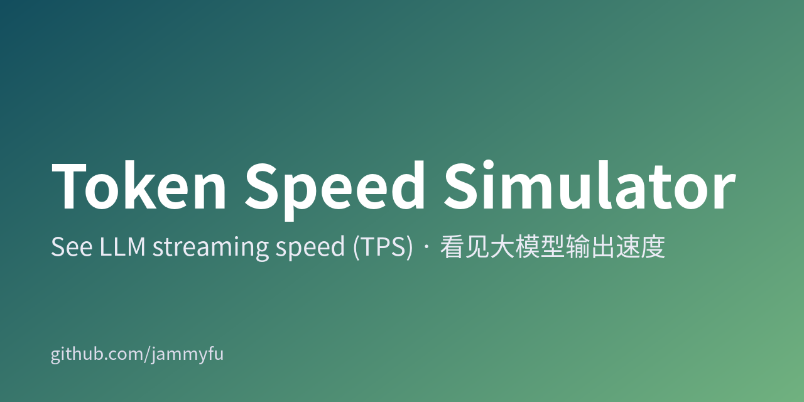
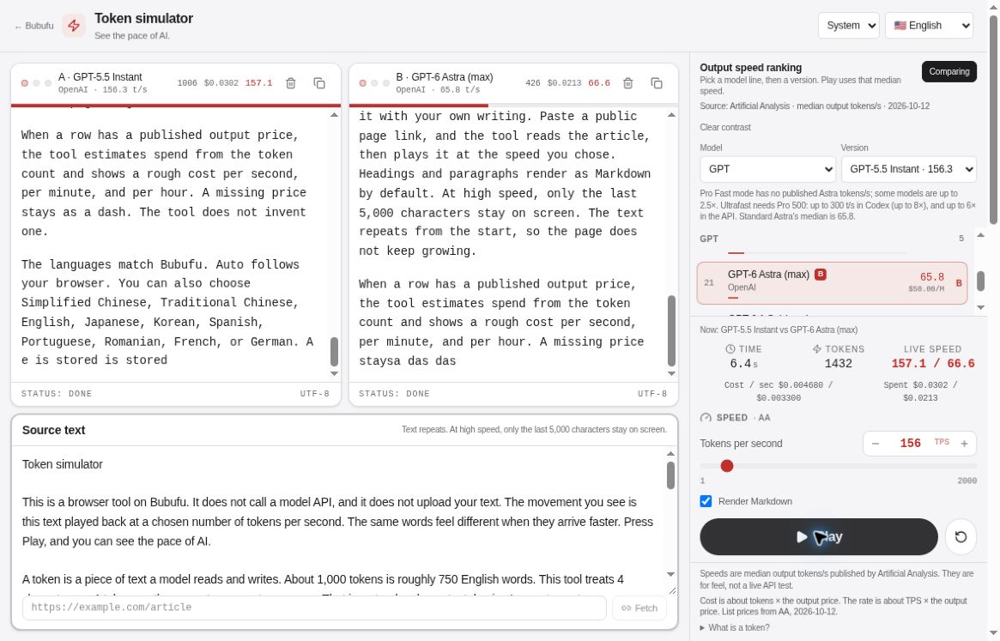

[简体中文](README.md) · [繁體中文](README.zh-TW.md) · [English](README.en.md) · [日本語](README.ja.md) · [한국어](README.ko.md)

# Token 速度模拟器

不用买一堆 API 额度，先看懂 20、50、200 TPS 的体感差别。

[**立即体验 →**](https://bubufu.com/tools/token-speed-simulator/)





## 30 秒上手

1. 选择模型系列和版本，或直接调整 **1–2000 TPS**。
2. 点击 **播放**，观察同一段文字的输出节奏。
3. 打开 **对比**，把另一条模型设为 B。两列使用同一份文本，更容易看清速度差异。

> 这是**浏览器文字播放模拟器，不是真实模型跑分**。不会调用模型 API，也不需要 API 密钥。上图是已部署产品的真实 A/B 播放截图，不是生成的效果图。

## 适合用来做什么

| 你想知道 | 怎么试 | 能得到什么 |
| --- | --- | --- |
| 20 TPS 和 100 TPS 读起来差多少？ | 相同文本、两种速度 | 直观比较阅读等待感 |
| 聊天产品需要多快？ | 粘贴自己的示例答复 | 讨论流式交互节奏，而不是猜数字 |
| 快一点会贵多少？ | 选有输出单价的模型 | 输出费用量级参考，不是账单 |
| 给同事解释 tokens/s | 播放或 A/B 对比 | 可现场演示的速度概念 |

支持 Markdown、编辑原文、按模型系列筛选和明暗主题。应用已有 **10 种语言**：简中、繁中、英语、日语、韩语、西班牙语、葡萄牙语、罗马尼亚语、法语、德语；本仓库提供五语使用文档。

## 数字要这样理解

- **Token 是近似值**：实现按 4 个字符约等于 1 token 播放，不调用真实分词器。中文、日文、韩文与英文的精确 token 数不能这样换算。
- **速度是快照，不是实时排名**：主数据来自 Artificial Analysis 2026-10-12 快照，部分条目有单独日期和来源，例如 2026-10-17 的 DeepSeek 更新。OpenRouter p50 与厂商公布的峰值不能当成同口径 AA 中位数。
- **费用只估输出**：约为模拟 token 数 × 输出美元单价 ÷ 1,000,000。不计输入、缓存、推理 token、折扣或实际账单；缺失价格保留空值。
- **不测首字延迟或质量**：网络、排队、上下文长度及设备渲染都可能影响真实体验。不要用这张表判断模型质量或承诺线上吞吐。
- 文本循环播放，只保留最近 5,000 个字符显示，避免页面无限增长。

## 本地运行

需要 Node.js LTS 与 npm。在终端执行：

```bash
git clone https://github.com/jammyfu/TokenSpeedSimulator.git
cd TokenSpeedSimulator
npm ci
npm run dev
```

打开 **http://localhost:3000/tools/token-speed-simulator/**。纯播放不需要 `.env.local` 或 Gemini/API 密钥。

```bash
npm run lint
npm run build
npm run preview
python3 tools/verify.py
```

构建产物在 `dist/`，默认部署路径是 `/tools/token-speed-simulator/`，不是站点根目录。Vite 开发/预览服务器提供页面抓取端点；静态托管需要相应后端，客户端还会尝试直接抓取及 Jina Reader 回退。

## 隐私、来源与常见问题

**文字会发给模型吗？** 不会，播放在浏览器中完成。**抓取网页不同**：目标 URL 会发送给抓取端点，回退时可能发送给 Jina Reader。只抓公开页面，不要粘贴私人链接、访问令牌或带敏感参数的地址。

**哪一个模型现在最快？** 本项目不能回答实时最快；请查看[原始排行榜](https://artificialanalysis.ai/leaderboards/models)及每条数据的日期。

**可以商用代码吗？** 当前仓库未提供 LICENSE。公开可读不等于已获商业复用授权，请先联系维护者；不要将其标为 MIT。

## 开发与贡献

- [Data / 数据 / 資料 / データ / 데이터](src/data/modelSpeedRankings.ts) · [Playback](src/hooks/useTokenStream.ts) · [Constants](src/constants.ts)
- [Contributing](CONTRIBUTING.md) · [Security](SECURITY.md) · [Roadmap](MASTER_PLAN.md) · [Current plan](CURRENT_PLAN.md)
- [Project brief](PROJECT_BRIEF.md) · [Backlog](TODO_BACKLOG.md) · [Worklog](docs/project-governance/WORKLOG.md)
- [Automation](docs/AUTOMATION_COMMANDS.md) · [Autonomy](docs/LONG_RUNNING_AUTONOMY.md) · [llms.txt](llms.txt)

欢迎提交带来源 URL、指标口径和核验日期的数据修正，或带复现步骤的界面问题。不要把不同测量口径混成统一排名。如果它帮你解释了 TPS，欢迎 Star，方便下次演示时找到它。
