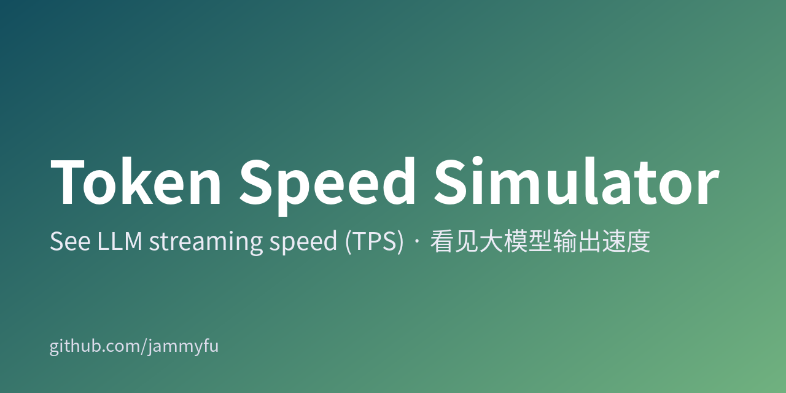
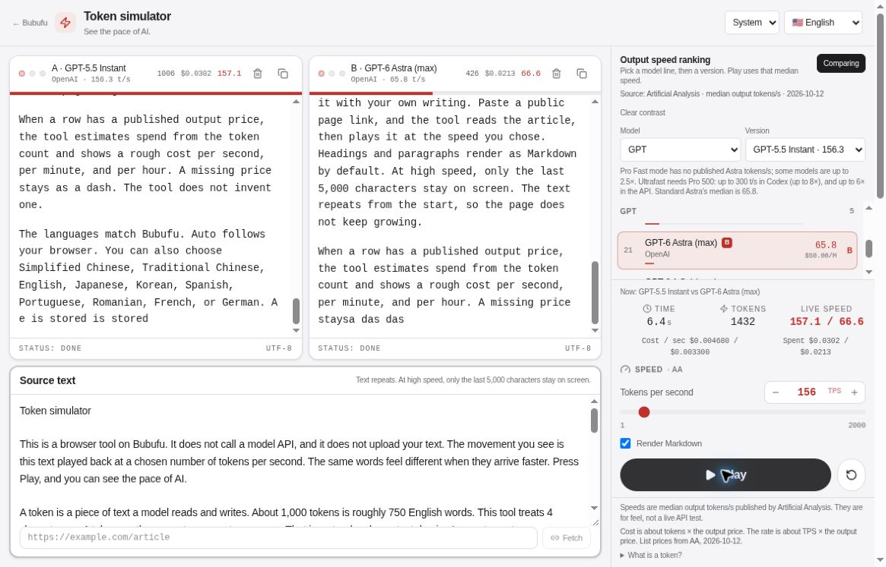

[简体中文](README.md) · [繁體中文](README.zh-TW.md) · [English](README.en.md) · [日本語](README.ja.md) · [한국어](README.ko.md)

# Token 速度模擬器

先看懂 20、50、200 TPS 的體感差異，再決定要不要買 API 額度。

[**立即試用 →**](https://bubufu.com/tools/token-speed-simulator/zh-hant/)





## 30 秒開始使用

1. 選擇模型系列與版本，或自行調整 **1–2000 TPS**。
2. 按下 **播放**，觀察同一段文字的輸出節奏。
3. 開啟 **比較**，將另一個模型設為 B。兩個區塊使用相同原文，速度差異更容易理解。

> 這是**瀏覽器文字播放模擬器，不是模型實測評比**。不會呼叫模型 API，也不需要 API 金鑰。上圖是已部署產品的真實 A/B 播放擷取畫面，不是生成的示意圖。

## 適合拿來做什麼

| 你想了解 | 試試看 | 可以觀察什麼 |
| --- | --- | --- |
| 20 TPS 和 100 TPS 讀起來差多少？ | 相同文字、兩種速度 | 閱讀時的等待感 |
| 聊天產品需要多快？ | 貼上自己的範例回覆 | 具體討論串流介面的節奏 |
| 更快的輸出可能貴多少？ | 選擇有輸出單價的模型 | 輸出費用的量級，不是帳單 |
| 如何向同事解釋 tokens/s？ | 播放或 A/B 比較 | 可以現場操作的示範 |

支援 Markdown、編輯原文、模型系列篩選及明暗佈景主題。應用程式已有 **10 種語言**：簡體中文、繁體中文、英語、日語、韓語、西班牙語、葡萄牙語、羅馬尼亞語、法語、德語；此儲存庫提供五語完整使用說明。

## 如何解讀數字

- **Token 是估算值**：播放時以 4 個字元約等於 1 token 計算，不使用模型的實際斷詞器。中文、日文、韓文與英文不能用這個比例計算精確 token 數。
- **資料快照，不是即時排行**：主要來源是 Artificial Analysis 的 2026-10-12 快照；個別項目有不同的日期與來源，例如 2026-10-17 的 DeepSeek 更新。OpenRouter p50 與廠商公布的峰值，不等同於 AA 中位數。
- **只估算輸出費用**：約為模擬 token 數 × 輸出美元單價 ÷ 1,000,000。不含輸入、快取、推理 token、折扣或實際帳務；未公布的價格保持空白。
- **不測首字延遲或品質**：網路、排隊、上下文長度與裝置繪製效能都可能影響實際體驗。不可據此判定模型品質或保證正式環境吞吐量。
- 文字循環播放，只顯示最後 5,000 個字元，避免頁面無限增長。

## 在本機執行

需要 Node.js LTS 與 npm，在終端機執行：

```bash
git clone https://github.com/jammyfu/TokenSpeedSimulator.git
cd TokenSpeedSimulator
npm ci
npm run dev
```

開啟 **http://localhost:3000/tools/token-speed-simulator/**。單純播放不需要 `.env.local` 或 Gemini/API 金鑰。

```bash
npm run lint
npm run build
npm run preview
python3 tools/verify.py
```

建置結果位於 `dist/`，預設部署路徑為 `/tools/token-speed-simulator/`，不是網域根目錄。Vite 開發／預覽伺服器提供網頁擷取端點；靜態託管需有對應後端，用戶端也會嘗試直接擷取與 Jina Reader 備援服務。

## 隱私、來源與常見問題

**文字會送給模型嗎？** 不會，播放在瀏覽器內完成。**網頁擷取則不同**：目標網址會傳送至擷取端點，使用備援服務時可能傳送至 Jina Reader。請只使用公開網頁，不要貼上私人連結、存取權杖或含敏感參數的網址。

**現在最快的是哪個模型？** 此工具無法確認即時冠軍，請查看[原始排行榜](https://artificialanalysis.ai/leaderboards/models)與每筆資料的日期。

**程式碼可以商用嗎？** 儲存庫目前沒有 LICENSE。公開可讀不等於已授權商業再利用，請先聯絡維護者，也不要自行標示為 MIT。

## 開發與貢獻

- [Data / 数据 / 資料 / データ / 데이터](src/data/modelSpeedRankings.ts) · [Playback](src/hooks/useTokenStream.ts) · [Constants](src/constants.ts)
- [Contributing](CONTRIBUTING.md) · [Security](SECURITY.md) · [Roadmap](MASTER_PLAN.md) · [Current plan](CURRENT_PLAN.md)
- [Project brief](PROJECT_BRIEF.md) · [Backlog](TODO_BACKLOG.md) · [Worklog](docs/project-governance/WORKLOG.md)
- [Automation](docs/AUTOMATION_COMMANDS.md) · [Autonomy](docs/LONG_RUNNING_AUTONOMY.md) · [llms.txt](llms.txt)

歡迎提供附來源網址、測量定義與查證日期的資料修正，或附重現步驟的介面問題。不要把不同測量方式混成單一排行。如果這個工具幫你說明了 TPS，歡迎加星，方便下次示範時找到它。
